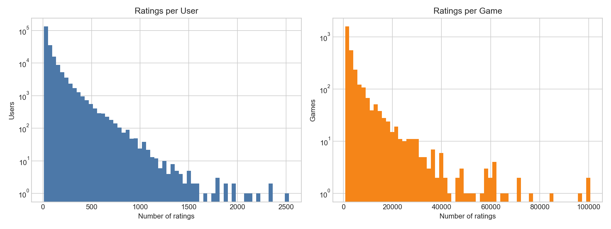
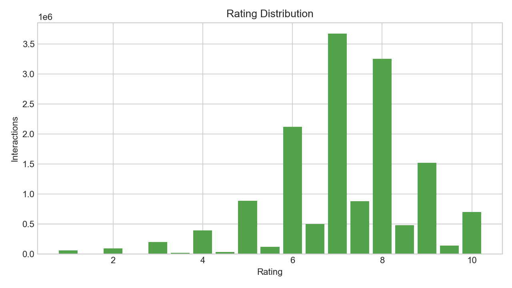

# Board Game Recommendation System

This machine learning project builds personalized board game recommendations from BoardGameGeek (BGG) user ratings.

## Dataset Selection

This project uses the **2022 v3 snapshot** of `jvanelteren/boardgamegeek-reviews`.

- Approximately 19 million user-game ratings
- Approximately 410,000 users and 22,000 games
- Metadata including player count, playtime, complexity, categories, and mechanics
- Suitable for comparing collaborative filtering and content-based recommendation on the same dataset

The newer v4 release is approximately 5.4 GB, which is unnecessarily large for this project. The official BGG rank CSV only contains aggregated game-level scores and does not provide the user-game interactions required for personalized recommendations. The v3 snapshot provides a better balance between scale and project scope.

The original source is the [BoardGameGeek XML API](https://boardgamegeek.com/wiki/page/XML%20API), and the redistributed dataset is available through [Kaggle BoardGameGeek Reviews](https://www.kaggle.com/datasets/jvanelteren/boardgamegeek-reviews). The BGG API terms should be reviewed before using the data.

## Preprocessing

The raw dataset contains **18,964,807 ratings across 21,839 games**, with interactions heavily concentrated among active users and popular games. The following rules keep enough interactions for model training while making the dataset manageable.

| Raw data | Criterion | Processing |
| --- | --- | --- |
| Missing user or game IDs and out-of-range ratings | Valid BGG ratings range from 1 to 10 | Removed 13 invalid rows |
| Some games have no detailed metadata or very few ratings | Ensure usable metadata and a minimum level of rating reliability | Kept games with metadata and at least 100 ratings |
| Ratings are concentrated among popular games | Balance training volume and computational cost | Selected the 3,000 most-rated eligible games |
| Many users have very little activity | Retain enough history for user preference learning | Removed users with fewer than 10 ratings in the selected catalog |
| Raw IDs are strings with large value ranges | Standardize model inputs | Encoded user and game IDs as zero-based integers |
| Random splits can change between runs | Ensure reproducibility | Split train/validation/test approximately 80/10/10 using a deterministic `(user, item)` hash |

The final dataset contains **212,439 users, 3,000 games, and 15,050,915 interactions**, with **97.64% sparsity**.





## Project Structure

```text
data/raw/        Original ZIP and CSV files (excluded from Git)
data/processed/  Cleaned and split datasets (excluded from Git)
notebooks/       Exploratory analysis and model experiments
reports/         Project reports and figures
src/             Download and preprocessing code
tests/           Preprocessing regression tests
```

## Modeling Roadmap

1. Use popularity-based recommendations as the baseline.
2. Implement collaborative filtering with Surprise SVD or implicit ALS.
3. Implement content-based recommendations using game categories, mechanics, and complexity.
4. Compare models using RMSE, Recall@10, NDCG@10, and coverage.
