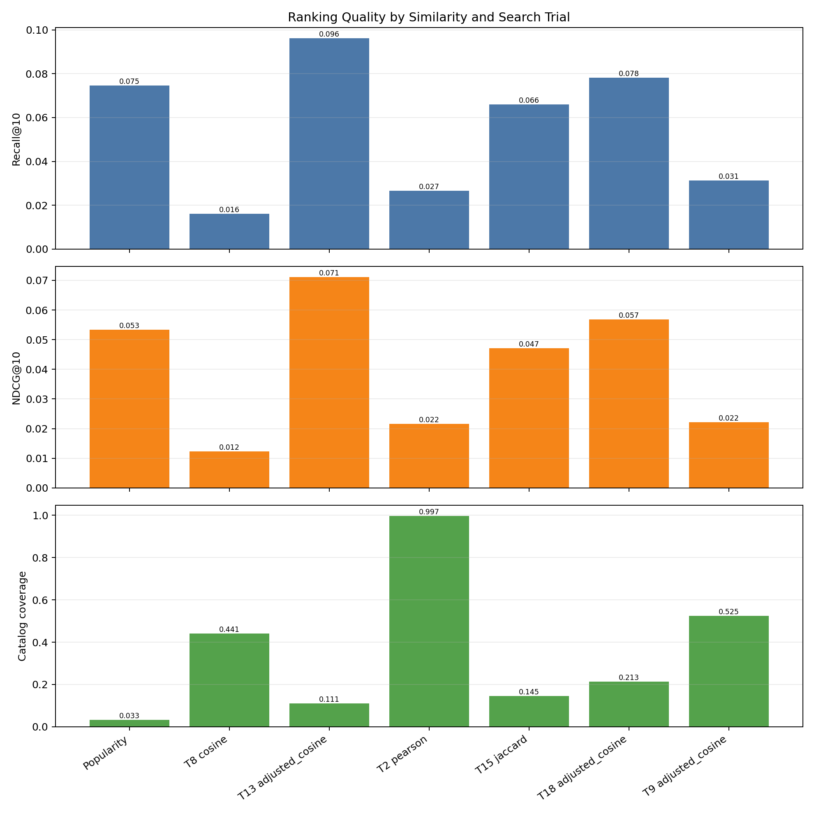
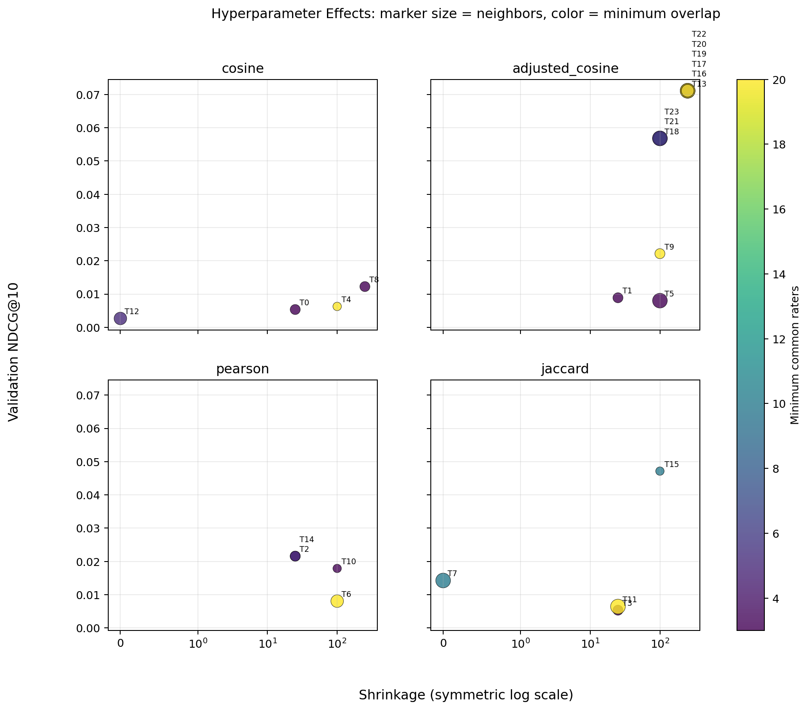
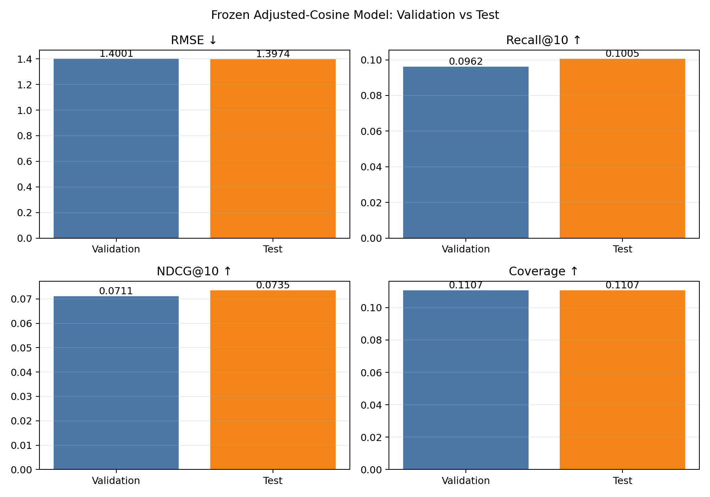

# 보드게임 아이템 기반 추천시스템 보고서

## 1. 프로젝트 개요

사용자가 과거에 높게 평가한 보드게임과 평가 패턴이 비슷한 다른
게임을 찾아 개인별 상위 10개 게임을 추천했다. 추천 방식은
**아이템 기반 협업 필터링(Item-based Collaborative Filtering)**이다.

이 방식은 "이 사용자가 좋아한 게임과 비슷한 게임은 무엇인가?"를
계산한다. 게임의 장르 설명만 비교하는 것이 아니라 여러 사용자가
실제로 남긴 평점 패턴을 사용한다.

## 2. 현재 완료한 작업

1. 원본 평점과 게임 정보의 결측치, 범위, 분포를 확인했다.
2. 원본 전처리 데이터는 보존하고 과제용 축소 데이터셋을 별도로 만들었다.
3. 인기 게임 추천을 개인화 모델과 비교하기 위한 기준 모델로 만들었다.
4. 코사인, 보정 코사인, 피어슨, 자카드 유사도를 구현했다.
5. 무작위 탐색 16개와 주변 격자 탐색 8개, 총 24개 설정을 비교했다.
6. 검증 데이터에서 보정 코사인 유사도를 최종 방식으로 선택했다.
7. 선택한 설정을 고정한 뒤 보관했던 테스트 데이터로 최종 평가를 1회 수행했다.
8. 결과표와 실험·하이퍼파라미터·최종 비교 그래프를 생성했다.
9. 데이터 처리, 추천 모델, 평가 지표에 대한 단위 테스트를 작성했다.

## 3. 데이터 구성

원본 데이터에서 게임 1,500개와 사용자 10,000명을 선정했다. 게임은
학습 데이터에서 평가 수가 많은 순서로 선택했다. 선택된 게임을 20개
이상 평가한 사용자 중 활동량 구간에 비례해 사용자를 추출했다.

검증 데이터와 테스트 데이터의 정보는 사용자나 게임을 선택할 때
사용하지 않았다. 따라서 평가용 정답이 전처리 과정에 미리 반영되는
데이터 누수를 방지했다.

| 구분 | 평점 수 | 사용 목적 |
| --- | ---: | --- |
| 학습 데이터 | 721,930 | 게임 간 유사도와 추천 모델 생성 |
| 검증 데이터 | 88,937 | 유사도 방식과 설정 선택 |
| 테스트 데이터 | 88,677 | 선택이 끝난 모델의 최종 성능 확인 |
| **전체** | **899,544** | 사용자 10,000명, 게임 1,500개 |

전체 사용자-게임 행렬의 약 94%는 평점이 없는 빈칸이다. 추천 데이터에서
흔한 희소 행렬이므로, 전체 행렬을 채우지 않고 희소 행렬 형식으로 처리했다.

## 4. 비교한 추천 방식

### 인기 게임 추천

평균 평점과 평가 수를 함께 고려해 누구에게나 동일한 인기 게임을
추천한다. 개인화 추천이 이 기준보다 실제로 나은지 판단하기 위해 사용했다.

### 코사인 유사도

두 게임의 사용자 평점 벡터가 같은 방향을 가리키는 정도를 비교한다.
계산은 간단하지만 평점을 후하게 주는 사용자와 엄격하게 주는 사용자의
차이를 직접 보정하지 못한다.

### 보정 코사인 유사도

각 사용자의 평균 평점을 먼저 빼고 게임을 비교한다. 개인마다 다른
평점 기준을 줄일 수 있어 이번 실험에서 가장 좋은 추천 순위 성능을 보였다.

### 피어슨 상관계수

두 게임을 모두 평가한 사람들의 평점 변화가 함께 움직이는 정도를
측정한다. 평점 오차와 추천 다양성은 좋았지만 상위 10개 추천 적중 성능은
보정 코사인보다 낮았다.

### 자카드 유사도

각 게임에 8점 이상을 준 사용자 집합이 얼마나 겹치는지 비교한다.
평점의 세밀한 차이보다 좋아했는지 여부를 중심으로 계산한다.

## 5. 설정 탐색

다음 값을 다양하게 바꾸어 총 24개 조합을 검증 데이터에서 비교했다.

- 유사 게임 수: 추천 점수를 계산할 때 참고하는 이웃 게임 수
- 최소 공통 평가자 수: 두 게임의 유사도를 인정하기 위한 최소 근거
- 유사도 보정 강도: 공통 평가자가 적을 때 우연히 큰 유사도가 나오는 현상을 완화
- 최소 유사도: 추천 계산에 포함할 유사도의 하한선
- 점수 결합 방식: 이웃 게임의 평점을 최종 추천 점수로 합치는 방법

첫 단계에서는 각 유사도에 같은 수의 무작위 탐색 기회를 주었다. 두 번째
단계에서는 가장 좋은 설정 주변의 값만 좁게 비교했다. 최종 테스트 데이터는
이 과정에서 읽지 않았다.

## 6. 평가 기준

보고서에서는 이해하기 쉬운 이름을 먼저 사용하고, 프로그램과 수업에서
쓰는 표준 이름은 괄호에 함께 표시했다.

- **평점 예측 오차(RMSE)**: 예상 평점과 실제 평점의 차이. 낮을수록 좋다.
- **좋아하는 게임 포함률(Recall@10)**: 사용자가 실제로 좋아한 게임 중
  추천 10개 안에 포함된 비율. 높을수록 좋다.
- **추천 순서 품질(NDCG@10)**: 좋아하는 게임을 추천 목록 위쪽에 배치한
  정도. 높을수록 좋다.
- **추천 게임 다양성(Catalog Coverage)**: 전체 게임 중 한 번이라도 추천된
  게임의 비율. 높을수록 다양한 게임이 노출된다.

추천시스템에서는 평점 예측 오차만 낮다고 좋은 추천이라고 판단할 수 없다.
실제로 좋아할 게임이 상위 10개 안에 들어오는지와 얼마나 위쪽에 배치되는지를
함께 확인해야 한다.

## 7. 검증 데이터 결과

| 추천 방식 | 평점 예측 오차 ↓ | 좋아하는 게임 포함률 ↑ | 추천 순서 품질 ↑ | 추천 게임 다양성 ↑ |
| --- | ---: | ---: | ---: | ---: |
| 인기 게임 추천 | 1.4138 | 0.0745 | 0.0534 | 0.0333 |
| 코사인 | 1.3725 | 0.0162 | 0.0122 | 0.4413 |
| **보정 코사인** | 1.4001 | **0.0962** | **0.0711** | 0.1107 |
| 피어슨 | **1.3584** | 0.0267 | 0.0216 | **0.9973** |
| 자카드 | 1.3910 | 0.0660 | 0.0471 | 0.1447 |

보정 코사인이 좋아하는 게임 포함률과 추천 순서 품질에서 가장 높아 최종
모델로 선정됐다. 피어슨은 평점 예측 오차가 가장 작았지만 상위 10개 추천
성능은 낮았다. 이 결과는 평점 예측과 추천 순위가 서로 다른 목표임을 보여준다.





## 8. 최종 모델 설정

- 추천 방식: 아이템 기반 협업 필터링
- 게임 유사도: 보정 코사인
- 참고할 유사 게임: 120개
- 최소 공통 평가자: 10명
- 유사도 보정 강도: 250
- 사용할 최소 유사도: 0.1
- 점수 계산: 유사도를 가중치로 사용한 평균
- 좋아하는 게임 기준: 평점 8점 이상
- 추천 목록 크기: 10개

## 9. 최종 테스트 결과

검증 데이터에서 설정을 모두 확정한 후 테스트 평점 88,677개를 한 번
평가했다. 테스트 결과를 확인한 뒤 설정을 다시 변경하지 않았다.

| 데이터 | 평점 예측 오차 ↓ | 좋아하는 게임 포함률 ↑ | 추천 순서 품질 ↑ | 추천 게임 다양성 ↑ |
| --- | ---: | ---: | ---: | ---: |
| 검증 | 1.4001 | 0.0962 | 0.0711 | 0.1107 |
| **최종 테스트** | **1.3974** | **0.1005** | **0.0735** | **0.1107** |

테스트 사용자가 실제로 좋아한 게임 가운데 약 10.05%가 추천 목록 10개
안에 포함됐다. 검증과 테스트 결과의 차이가 작아 선택한 모델이 새로운
평점 데이터에서도 비슷한 수준으로 동작했다고 볼 수 있다.



## 10. 코드와 재현 방법

```bash
# 과제용 데이터 생성
.venv/bin/python -m src.create_experiment_subset \
  --max-items 1500 --max-users 10000 \
  --min-user-train-ratings 20 --seed 42

# 검증 데이터에서 24개 설정 비교
.venv/bin/python -m src.item_cf_experiment \
  --train data/experiment_10k/train.csv \
  --validation data/experiment_10k/validation.csv \
  --total-users 10000 --total-items 1500 --sample-users 10000 \
  --trials 16 --grid-trials 8 \
  --output-dir reports/item_cf_10k

# 확정된 모델의 최종 테스트 평가
.venv/bin/python -m src.final_item_cf_test
```

주요 파일은 다음과 같다.

- `src/create_experiment_subset.py`: 데이터 축소와 ID 재배정
- `src/item_cf.py`: 네 가지 게임 유사도와 추천 점수 계산
- `src/item_cf_experiment.py`: 무작위·격자 탐색, 검증, 그래프 생성
- `src/final_item_cf_test.py`: 고정된 모델의 최종 테스트 평가
- `src/metrics.py`: 네 가지 평가 기준 계산
- `item_cf_10k/item_cf_trials.csv`: 전체 24개 실험 결과
- `item_cf_10k/final_test_metrics.json`: 최종 수치 원본

## 11. 이후 진행할 작업

### 제출 전에 필요한 작업

- 노트북 또는 발표 자료에 핵심 그래프와 해석을 배치한다.
- 실행 환경과 필요한 패키지가 README의 재현 명령과 일치하는지 확인한다.
- 최종 보고서에서 테스트 결과를 본 뒤 설정을 바꾸지 않았음을 명시한다.
- 변경 파일을 커밋하고 GitHub 원격 저장소에 push한다.

### 시간이 남으면 할 수 있는 확장

- 특정 사용자의 평가 이력과 실제 추천 게임 예시를 표로 제시한다.
- 게임 장르·메커니즘을 사용하는 콘텐츠 기반 모델과 비교한다.
- 아이템 기반 결과와 콘텐츠 기반 결과를 합친 하이브리드 추천을 실험한다.
- 신규 사용자나 평가가 적은 게임에서 발생하는 콜드 스타트 문제를 분석한다.

이 확장 작업은 현재 아이템 기반 모델의 최종 테스트 결과를 변경하기 위한
작업이 아니다. 새로운 모델을 별도 실험으로 비교할 때만 수행한다.

## 12. 최종 결론

사용자별 평점 기준을 보정하는 보정 코사인 방식이 이번 데이터에서 가장
좋은 상위 10개 추천 성능을 보였다. 최종 테스트에서도 검증 결과와 비슷한
성능이 유지됐다. 또한 피어슨 방식의 평점 오차가 가장 작았음에도 추천 순위
성능은 낮았기 때문에, 추천시스템은 평점 오차뿐 아니라 좋아하는 게임 포함률,
추천 순서 품질, 추천 다양성을 함께 평가해야 한다.
